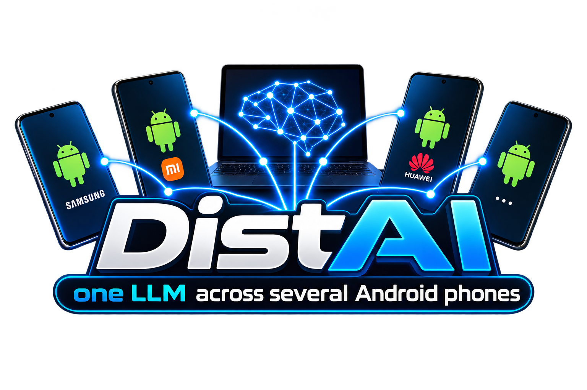

<p align="center"></p>

# DistAI: one LLM across several Android phones

DistAI pools the RAM and CPUs of ordinary ARM64 smartphones (plus a PC or a Raspberry Pi, if you have one) to run a single language model
that would not fit on any one of them. It is an Android app and a set of PC tools built on [llama.cpp](https://github.com/ggml-org/llama.cpp)
and its **RPC** backend.

```
            ┌────────────── Wi-Fi / USB / Ethernet ──────────────┐
  [Coordinator]  llama-server --rpc ...  :8080 (OpenAI API + chat)
        │  └─ local worker  ggml-rpc-server :50052
        ├──► Phone 2   ggml-rpc-server :50052   layers 9-16
        ├──► Phone 3   ggml-rpc-server :50052   layers 17-24
        └──► PC / Raspberry Pi / Phone N ...
```

## Goal and outcome

**Goal:** run an LLM larger than any single phone can hold, on common smartphones, at a usable token rate.

- **Distributing a model across phones works.** Nodes discover each other, layers are split automatically, and the cluster serves a chat UI and an OpenAI-compatible API.
- **It costs speed.** The RPC pipeline adds up the *memory* of the devices, not their *speed*: every token crosses all phones in sequence and pays the network latency at each hop.
  A 7B model on a PC plus a phone runs at about 2 tok/s. A 30B model that does 7.0 tok/s on the PC alone drops to 3.9 when split.
- **Speed is recovered by other means** (see below): mixture-of-experts models, batching, replicas, and a wired link. The cluster reaches 39 tok/s in total for several users.

## What it does today

- **Android app** (`app/`): every phone becomes a node and announces itself over mDNS. One phone acts as coordinator: it downloads the model, computes the layer split,
  starts `llama-server` and opens a built-in chat. It also runs automatic benchmarks, keeps the service alive (foreground service, wake lock) and has a "Free RAM" button.
- **PC node** (`tools/pcnode.py`): Linux, Windows and macOS join the cluster like any phone; a dedicated GPU (Vulkan/Metal) can be a separate node.
- **Optimized ARM binaries**: three builds (`v8`, `v82`, `v86`), picked at runtime from the CPU features.
- **llama.cpp patches** (`native/patches/`): repacked kernels and a persistent threadpool inside the RPC workers.
- **Measurement tools** (`tools/`): token/s and latency benchmarks, a quality test on 22 coding tasks, a replica router, a split planner.
- **Experimental diffusion engine** (BD3LM block diffusion on ggml): `native/patches-sperimentali/`.

## Techniques used

| Technique | Effect |
|---|---|
| Layer pipeline over llama.cpp RPC | lets a model span several devices |
| Weighted split planner (free RAM, bandwidth, latency; slow nodes excluded) | uses each device in proportion; Android free RAM counts for about 50% |
| mDNS discovery, manual IP fallback | zero-configuration cluster |
| Output layer kept on the coordinator | avoids sending ~600 KB of logits per token: 3.5 → 5.3 tok/s |
| Repacked kernels in RPC workers (`rpc-repack.patch`) | prompt ×4.7, prefill over RPC ×3-4 |
| Persistent threadpool, pinned big cores, flash attention, polling | Xiaomi +23% (v82/v86 only) |
| Per-CPU binaries (`v8`/`v82`/`v86`) | dotprod, fp16 and i8mm where available |
| Mixture-of-experts models, fewer active experts (8 → 6) | Qwen3-Coder-30B-A3B at 7-8 tok/s on a PC; +12-25% with no quality loss |
| Batching (several requests at once) | Xiaomi 8 → 22.8 tok/s with 4 users |
| Replicas + router, agent queue | 22 coding tasks in 67.7 s instead of 203 s (3.0×) |
| Speculative decoding, enabled only if measured to help | +13% on one phone, off elsewhere |
| USB cable (adb forward, USB tethering, Ethernet) instead of Wi-Fi, lowest-latency channel chosen automatically | 237 MB/s vs ~2 MB/s, ~2 ms latency |
| Wi-Fi keepalive, wake lock, battery-optimization opt-out | removes 200+ ms latency spikes and background kills |

## Pros and cons

**Pros**
- Runs models too big for one phone, on hardware people already own.
- No setup beyond installing the app: discovery, split and model transfer are automatic.
- Scales well for several users or agents (replicas), and works with PCs and Raspberry Pis.
- Every claim in the docs is measured, including what did not work.

**Cons**
- A single conversation is never faster than the fastest device that could hold the whole model; a split model is slower than a model that fits.
- Old phones without dotprod (for example Kirin 970) are slow: about 3.4 tok/s on a 3B model.
- Wi-Fi is unreliable for latency; a cable is much better.
- The RPC protocol has no authentication or encryption: use it on a trusted private network only.
- Dense 27B/70B models at 50-100 tok/s are out of reach for phones (see [`ROADMAP.md`](ROADMAP.md)).

## Step by step: a 14B model on three phones over USB

This is the exact procedure used to run **Qwen2.5-Coder-14B-Instruct (Q3_K_M, 7.3 GB)** split evenly over three phones, driven from a Linux PC
through the USB cable only (`adb forward`, no Wi-Fi). Speed is not the goal here (a split model is slow); it is a demo that the model really lives in the phones' RAM.

**You need:** a Linux PC with ~12 GB of free disk, Python 3, `adb` ([platform-tools](https://developer.android.com/tools/releases/platform-tools)),
cmake and a C/C++ compiler; three ARM64 phones with at least ~3 GB of *free* RAM each; USB cables (a powered hub if the PC has few ports).

**1. Enable USB debugging on every phone**
1. *Settings → About phone* → tap **Build number** 7 times (developer mode).
2. *Settings → Developer options* → turn on **USB debugging** (and **Stay awake** while charging). On Xiaomi/MIUI also turn on *Install via USB*.
3. Plug the phone in and accept the "Allow USB debugging?" prompt (tick *Always allow*).
4. Check that every phone is listed as `device` (not `unauthorized`) and note the serials:
   ```bash
   adb devices -l
   ```

**2. Build and install the APK on every phone**
```bash
./gradlew assembleDebug                      # APK in app/build/outputs/apk/debug/app-debug.apk
adb -s SERIAL_1 install -r app/build/outputs/apk/debug/app-debug.apk
adb -s SERIAL_2 install -r app/build/outputs/apk/debug/app-debug.apk
adb -s SERIAL_3 install -r app/build/outputs/apk/debug/app-debug.apk
```
If `install -r` fails with a signature mismatch, uninstall first: `adb -s SERIAL uninstall com.distai.app`.
(The ARM binaries must already be in `app/src/main/jniLibs`: run `./native/build-android.sh` once, see [Build](#build).)

**3. Start the worker on every phone**
Open the **DistAI** app on each phone. It starts a foreground service with an RPC worker on port `50052`.
Grant the notification permission, disable battery optimization for the app, keep the phone charging, and tap **Free RAM** before loading a big model.
Do **not** start the coordinator on any phone: here the PC is the coordinator.

**4. Build the PC side**
```bash
git clone https://github.com/ggml-org/llama.cpp native/llama.cpp
git -C native/llama.cpp checkout 69f201a     # same commit as the phones: the RPC protocol must match
python native/build-pc.py                    # llama-server in native/build-pc/bin (patches applied automatically)
```

**5. Download the model**
```bash
mkdir -p ~/distai-models
curl -L -C - -o ~/distai-models/qwen2.5-coder-14b-instruct-q3_k_m.gguf \
  https://huggingface.co/Qwen/Qwen2.5-Coder-14B-Instruct-GGUF/resolve/main/qwen2.5-coder-14b-instruct-q3_k_m.gguf
```
`-C -` resumes an interrupted download. The file must be exactly 7339203968 bytes.

**6. Launch the cluster**
```bash
export SERIAL_XIAOMI=SERIAL_1 SERIAL_HUAWEI=SERIAL_2 SERIAL_SAMSUNG=SERIAL_3   # names are only labels: any three phones work
python3 tools/video14b.py
```
`tools/video14b.py` does the following:
- creates an `adb forward` from the PC to the RPC worker of each phone (`127.0.0.1:50151..50153` → phone `:50052`);
- starts `llama-server` on the PC (`:8090`) with `-ngl 49 -ts 1,1,1` and the embedding/output tensors kept on the CPU: all 48 layers go to the phones, one third each (~2.3 GB per phone),
  so only the small hidden state crosses the cable for each token;
- starts the PC dashboard on `http://127.0.0.1:8099`.

The weights travel over USB while `llama-server` loads the model; the script prints `PRONTO` when `/health` answers. You can watch the RAM of each phone
filling up in the dashboard. Use another model with `python3 tools/video14b.py other-model.gguf` (file in `~/distai-models`), or another `llama-server` with `LLAMA_SERVER=/path/to/llama-server`.

**7. Generate**
- Open **http://127.0.0.1:8099/**: for each phone it shows real CPU and RAM (read with `adb`), and the text streams as the cluster writes it.
- Or use the OpenAI-compatible API directly:
  ```bash
  curl http://127.0.0.1:8090/v1/chat/completions -H 'Content-Type: application/json' \
    -d '{"messages":[{"role":"user","content":"Write a Python function that computes the primes up to n."}],"max_tokens":200}'
  ```

**8. Stop**
```bash
pkill -x llama-server; pkill -f tools/dashboard.py
```
Close the app on the phones to free their RAM.

**Troubleshooting**
- `Failed to create server socket` in the phone's `rpc.log` is harmless: the app's worker already owns port `50052` and the script uses that one.
- A phone is shown as *off* in the dashboard: check `adb devices`, then that the app is running (the worker is the `librpcserver` process).
- The model does not fit: lower the context (`-c`) or use a smaller quantization; keep ~1.5-2 GB per phone for Android (see [How much model fits](#how-much-model-fits)).
- If a cable is unplugged the `adb forward` disappears: stop and run `tools/video14b.py` again (the workers keep the weights in their cache, so the second start is faster).
- Never put serials, IPs or home paths in commits: this repository is public.

## Documentation

| File | Contents |
|---|---|
| [`ROADMAP.md`](ROADMAP.md) | Goal, ideas still to test (diffusion LLMs, distributed experts, ...) |
| [`NOTES.md`](NOTES.md) | Measurements, what was discarded, per-device checklist |
| [`native/patches-sperimentali/README.md`](native/patches-sperimentali/README.md) | Experimental patches and their outcomes |

## Quick start

1. Install the APK on every phone (`adb install -r DistAI.apk`).
2. Put all devices on the same network. Turn off "client isolation" on the router if it is on.
3. Open the app on each phone: it becomes a **worker**. Disable battery optimization and keep the phones charging.
4. On **one** phone (preferably the one with the most RAM), open the *Coordinator* section:
   pick a model → **Download model** (or copy a `.gguf` to `Android/data/com.distai.app/files/models/`) →
   **Start distributed LLM** → when ✅ appears, **Open chat**.
5. From a PC on the same network, use the OpenAI-compatible API at `http://COORDINATOR-IP:8080/v1`.

### How much model fits

A Q4_K_M model takes about 0.6 GB per billion parameters plus the context cache. Leaving 1.5-2 GB to Android on each phone:

| Model | File | 6-8 GB phones needed |
|---|---|---|
| 0.5B-3B | 0.4-2 GB | 1 |
| 7-8B | ~5 GB | 1-2 |
| 14B | ~9 GB | 2-3 |
| 32B | ~20 GB | 4-6 |
| 70B | ~42 GB | 8-12 |

Use as few nodes as the model requires. Splitting a model that already fits on one device makes it slower.

### Connection

Prefer a cable: USB with a recent `adb` (Android SDK platform-tools; the old adb 1.0.32 managed only 3.9 MB/s), USB tethering, or a USB-C Ethernet adapter.
Without a cable, use 5 GHz or Wi-Fi 6 with the phones close to the router, and check the Wi-Fi power-save notes in [`NOTES.md`](NOTES.md).

## ARM variants

| Variant | `-march` | Typical CPUs |
|---|---|---|
| `v86` | armv8.6-a+dotprod+fp16+i8mm | Snapdragon 8 Gen 1+, Dimensity 9000+, Tensor G2+ |
| `v82` | armv8.2-a+dotprod+fp16 | Snapdragon 845-888, Exynos 9810+, Kirin 980+ |
| `v8` | armv8-a | all other ARM64 |

## Build

Requirements: Android SDK, NDK (tested with r29), JDK 17+, cmake, Python 3.

```bash
git clone https://github.com/ggml-org/llama.cpp native/llama.cpp
git -C native/llama.cpp checkout 69f201a      # reference commit (2026-10-10)
./native/build-android.sh                     # arm64 binaries (3 variants) in app/src/main/jniLibs
./gradlew assembleRelease                     # APK in app/build/outputs/apk/release/
```

On Windows use `gradlew.bat` (JDK 17). Opening the project in Android Studio creates `local.properties` with `sdk.dir`.

### The PC as a node (Linux, Windows, macOS)

```bash
python native/build-pc.py        # ggml-rpc-server and llama-server in native/build-pc/bin
pip install zeroconf             # mDNS announcement (on Linux, avahi also works)
python tools/pcnode.py           # worker :50052, status :50053, coordinator on demand :8090
```

- GPU: `python native/build-pc.py --gpu` and `python tools/pcnode.py --gpu` make the PC **two nodes** (CPU and GPU) with separate benchmarks.
  With an integrated GPU the CPU alone is usually faster.
- You need cmake and a C/C++ compiler (gcc/clang; on Windows MSVC Build Tools or [llvm-mingw](https://github.com/mstorsjo/llvm-mingw)).
- On Windows, allow `ggml-rpc-server` and `python` through the firewall on private networks.

### Measurement tools

Scripts in `tools/` read phone serial numbers from `SERIAL_XIAOMI`, `SERIAL_HUAWEI` and `SERIAL_SAMSUNG` (find yours with `adb devices`)
and take IPs as parameters (`--help`). Adapt the device names in `tools/lbench.py` to your own.

## Tested devices

Samsung Galaxy Note 10 (Exynos 9825), Huawei Mate 10 Pro (Kirin 970), a Xiaomi with a MediaTek SoC, Raspberry Pi 4/5, and a PC with an i7-7700.
All are old or mid-range; recent phones with `i8mm` (the `v86` build) should do better.

## Status

Experimental. It works and the measurements are reproducible, but the UI is rough and the app strings and code comments are in Italian.
Measurements on other phones are welcome: add a column to the checklist in [`NOTES.md`](NOTES.md).

## License and credits

- [MIT](LICENSE) (third-party notice: [THIRD_PARTY_NOTICES.md](THIRD_PARTY_NOTICES.md)). Built on [llama.cpp](https://github.com/ggml-org/llama.cpp) (MIT) and [ggml](https://github.com/ggml-org/ggml); the patches in `native/` modify that code.
- Each model (Qwen, LFM2, Stable-DiffCoder, ...) has its own license: check it before redistributing.
